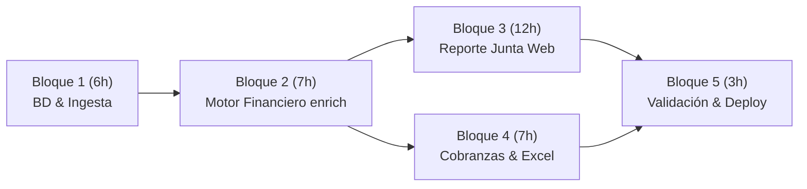

# Plan de Implementación: Módulo de Reportes y Cobranza (Lila)
## Alcance Base: 35 Horas de Desarrollo Asistido por IA

**Proyecto:** Plataforma Lila (`github.com/juntospace/lila`)  
**Módulo:** Cartera & Reportes (`/portfolio`)  
**Autor / Responsable:** Carluis  
**Fecha:** Octubre 2026  
**Estimación Total:** 35 Horas (\$700 USD a \$20/h)  
**Tiempo Calendario:** 5 a 7 días hábiles  

---

## 1. Resumen Ejecutivo y Objetivo

El objetivo de este plan es migrar y poner en producción dentro de la plataforma web de Lila (`Next.js 16 / React 19 / Supabase PostgreSQL`) la herramienta analítica que actualmente corre en local en Python (`lila-board-report` y `lila-acciones`).

El plan está estrictamente acotado a las **35 horas del alcance base**, aprovechando la aceleración de herramientas de IA para portar algoritmos y maquetar interfaces, garantizando paridad matemática exacta contra los resultados de Python.

---

## 2. Desglose Detallado por Bloques de Trabajo

---

### Bloque 1: Base de Datos e Ingesta en Supabase (6 Horas)
**Objetivo:** Reemplazar el almacenamiento local de carpetas/CSVs en Windows por persistencia estructurada e idempotente en PostgreSQL.

* **Tarea 1.1: Esquema de Base de Datos y Migraciones (2.5 h)**
  * Crear migración en Supabase (`supabase/migrations/`) con las tablas requeridas:
    * `portfolio_snapshots`: Registro maestro por fecha de corte y entidad.
    * `portfolio_loans`: Detalle enriquecido por préstamo para cada snapshot.
    * `portfolio_loan_repayments`: Historial de pagos para reportería de cobros.
  * Añadir columnas clave:
    * `dpd` (ajustado) y `dpd_loandisk` (original sin alterar).
    * `cash_ahead` (booleano de ajuste de caja).
    * Campos personalizados normalizados: `pg` (garantía), `tg` (tipo garantía), `tc` (cartera), `gc` (gestor) y `mr` (motor de riesgo).
* **Tarea 1.2: Pipeline de Ingesta Idempotente (2.5 h)**
  * Parser en TypeScript para procesar los CSVs de LoanDisk (`loans_*.csv` y `repayments_*.csv`).
  * Manejo estricto de fechas formato día-primero (`%d/%m/%Y`).
  * Idempotencia por fecha: Si se sube una versión corregida del mismo día, sobrescribir limpiamente el snapshot de esa fecha sin duplicar filas ni corromper el histórico.
* **Tarea 1.3: Filtros de Integridad y Pagos Futuros (1.0 h)**
  * Exclusión automática de pagos con fecha posterior a la fecha de corte del lote (errores humanos de LoanDisk), preservando la fecha de corte intacta.

---

### Bloque 2: Motor Financiero en TypeScript — `enrich` (7 Horas)
**Objetivo:** Trasladar la lógica financiera de Python a TypeScript estricto como fuente única de verdad para Junta y Cobranzas.

* **Tarea 2.1: Universo Abierto y Segmentación de Cartera (2.0 h)**
  * Regla de cartera abierta: `balance > 0.5` y estatus distinto de `"fully paid"` y `"restructured"`.
  * Asignación de 3 segmentos por precedencia estricta:
    1. Si producto contiene `"adelanto"` $\rightarrow$ `Adelantos` (prioridad absoluta).
    2. Si `Préstamo Garantizado` es `"Si"` o producto contiene `"con garant"` / `"vehicular"` $\rightarrow$ `Personal con Garantía`.
    3. Default o `Préstamo Garantizado` `"No"` $\rightarrow$ `Personal sin Garantía`.
* **Tarea 2.2: Ajuste de Caja (`cash_ahead`) (2.0 h)**
  * Reconciliación entre saldo vencido y contador de días:
    $$\text{cash\_ahead} = (\text{Past Due} \le 0.01 \lor \text{Pending Due} \le 0.01) \land \text{dpd} > 0 \land \text{is\_open}$$
  * Si `cash_ahead` es verdadero, forzar `dpd = 0` (clasificado como *"Al día"*), conservando `dpd_loandisk` intacto para auditoría.
  * Asignación de los 7 tramos DPD: `["Al día", "1-30", "31-60", "61-90", "91-180", "181-365", "365+"]`.
* **Tarea 2.3: Clasificación de Métodos de Recaudación (1.5 h)**
  * Separación de cobros reales (ACH, Cheque, Yappy, Depósito en Efectivo, Débito Planilla) de movimientos administrativos (Traspasos, Finiquitos, Descuentos).
  * Alerta visual para métodos desconocidos (se cuentan como reales pero se notifican).
* **Tarea 2.4: Tests Unitarios del Motor (1.5 h)**
  * Tests automatizados en Vitest/Jest que comparen los cálculos de `enrich` en TypeScript contra un dataset de prueba procesado por Python.

---

### Bloque 3: Reporte de Junta Directiva Web (`/portfolio/board`) (12 Horas)
**Objetivo:** Desarrollar la pantalla ejecutiva de la Junta en Next.js con interactividad completa y drilldowns a nivel de préstamo.

* **Tarea 3.1: Sección 01 — Resumen Ejecutivo (2.0 h)**
  * KPI Cards: Saldo Abierto, CeR 30+ (con umbrales RAG: $\le 15\%$ verde, $\le 28\%$ ámbar, $> 28\%$ rojo), CeR 90+ y Recaudado desde junio de 2025.
  * Cálculo dinámico de deltas contra el corte previo.
* **Tarea 3.2: Sección 02 — Distribución de Mora y Provisiones (2.5 h)**
  * Gráfico de barras apiladas horizontales por segmento con paleta corporativa Junto.
  * Cálculo de provisión estimada con la escala CRO: `[1%, 5%, 15%, 25%, 50%, 90%, 100%]`.
  * Cálculo de valor neto estimado de la cartera.
* **Tarea 3.3: Sección 03 — Matriz de Transición 7x7 (2.0 h)**
  * Cuadrícula de roll-rates comparando tramo inicial vs. tramo final entre dos snapshots.
  * Formato condicional: verde (mejora de tramo), rojo (deterioro) y neutro.
* **Tarea 3.4: Sección 04 — Recaudación: Cobrado vs. Programado (2.0 h)**
  * Barras apiladas de recaudación real (principal + ingresos).
  * Cálculo de cuotas programadas proyectadas cuota a cuota desde la fecha de desembolso (`Released Date`).
  * Indicador de eficiencia de cobranza ($\ge 85\%$ verde, $\ge 60\%$ ámbar, $< 60\%$ rojo).
* **Tarea 3.5: Sección 05 & 06 — Serie Histórica y Cosechas (1.5 h)**
  * Evolución temporal de mora (saldo \$ vs. % en mora).
  * Tabla de cosechas agrupadas por año de desembolso, con partición del corte de gestión del 1 de junio de 2025 (*Anterior* vs. *Nueva*).
* **Tarea 3.6: Modales de Drilldown y Exportación CSV (2.0 h)**
  * Apertura de modal con lista detallada de préstamos al hacer clic en cualquier barra, celda de la matriz o cosecha.
  * Botón de descarga en formato CSV compatible con Excel (delimitador punto y coma `;` y cabecera UTF-8 BOM).

---

### Bloque 4: Plan Diario de Cobranzas y Generador Excel (7 Horas)
**Objetivo:** Proveer al equipo operativo (CORA) su herramienta de trabajo diaria con priorización de cuentas y descarga directa en `.xlsx`.

* **Tarea 4.1: Motor de Priorización y Scoring (2.5 h)**
  * Algoritmo de clasificación de cuentas accionables:
    * **P1:** Contador desfasado (`cash_ahead`) y cuentas que rodaron a un tramo peor.
    * **P2:** *Cura barata* (mora 1–90 con saldo vencido bajo) y cuentas a $\le 7$ días de rodar de tramo.
    * **P3:** Clientes en mora 91+ con pago real en los últimos 90 días.
  * Exclusión estricta de castigos: DPD superior al umbral (180 días sin garantía / 360 días con garantía) sin pagos en $\ge 180$ días.
* **Tarea 4.2: Vista Web de Cobranzas (1.5 h)**
  * Interfaz con pestañas: *Hoy (Top 40)*, *Todos los accionables* y *Resumen ejecutivo*.
  * Tabla con información de contacto, saldo, monto a cobrar y motivo de acción.
* **Tarea 4.3: Generador Nativo de Excel `.xlsx` (3.0 h)**
  * Generación en el servidor mediante librería `exceljs`:
    * Pestaña 1: *Hoy* (Top 40 priorizado).
    * Pestaña 2: *Todos los accionables*.
    * Pestaña 3: *Resumen*.
  * Estilos visuales exactos a `openpyxl`: paleta violeta Junto, freeze panes, anchos de columna automáticos, colores por nivel de prioridad y formato de moneda.

---

### Bloque 5: Validación, Pruebas y Despliegue (3 Horas)
**Objetivo:** Asegurar que los números en producción sean idénticos a los de Python y desplegar el módulo.

* **Tarea 5.1: Validación de Paridad Matemática (1.5 h)**
  * Ejecutar el script original de Python sobre un backup real y contrastar los resultados contra la base de datos de Lila.
  * Verificar que saldos, tramos, provisiones y asignaciones de prioridad coincidan al centavo.
* **Tarea 5.2: Despliegue y Pruebas en Staging/Producción (1.5 h)**
  * Verificación de build en Vercel, permisos de acceso para operadores y prueba de flujo de carga y descarga en vivo.

---

## 3. Cronograma Estimado de Ejecución

| Día | Foco Principal | Bloques / Tareas | Horas |
|:---:|---|---|:---:|
| **Día 1** | Base de Datos e Ingesta | Migraciones Supabase + Parser de CSVs e idempotencia | 6 h |
| **Día 2** | Motor Financiero `enrich` | Reglas de segmentos, `cash_ahead` y tests unitarios | 7 h |
| **Día 3** | Reporte de Junta (Parte 1) | KPIs Resumen, Distribución de mora y Matriz 7x7 | 6 h |
| **Día 4** | Reporte de Junta (Parte 2) | Recaudación, Cosechas, Modales y descarga CSV | 6 h |
| **Día 5** | Plan de Cobranzas & Excel | Scoring P1/P2/P3, UI de Cobranza y generador `.xlsx` | 7 h |
| **Día 6** | QA, Paridad y Despliegue | Validación centavo a centavo contra Python y release | 3 h |
| | **TOTAL** | | **35 h** |

---

## 4. Criterios de Aceptación (Definition of Done)

1. [ ] **Idempotencia:** Cargar un backup de la misma fecha dos veces reemplaza el snapshot limpiamente sin duplicar datos.
2. [ ] **Paridad de Mora:** Los préstamos con monto vencido en \$0 pero contador DPD $>0$ se clasifican como *"Al día"* reflejando `cash_ahead`.
3. [ ] **Junta Directiva:** Las 6 secciones del `/portfolio/board` renderizan correctamente y permiten descargar la lista de préstamos en CSV con acentos correctos en Excel.
4. [ ] **Cobranzas:** El botón de descarga genera un archivo `.xlsx` de 3 pestañas idéntico al emitido por la herramienta local de Antonio.
5. [ ] **Cero discrepancias:** El total de saldo abierto y la cartera en riesgo (CeR) del reporte web coinciden exactamente con los generados por `generate_report.py`.

